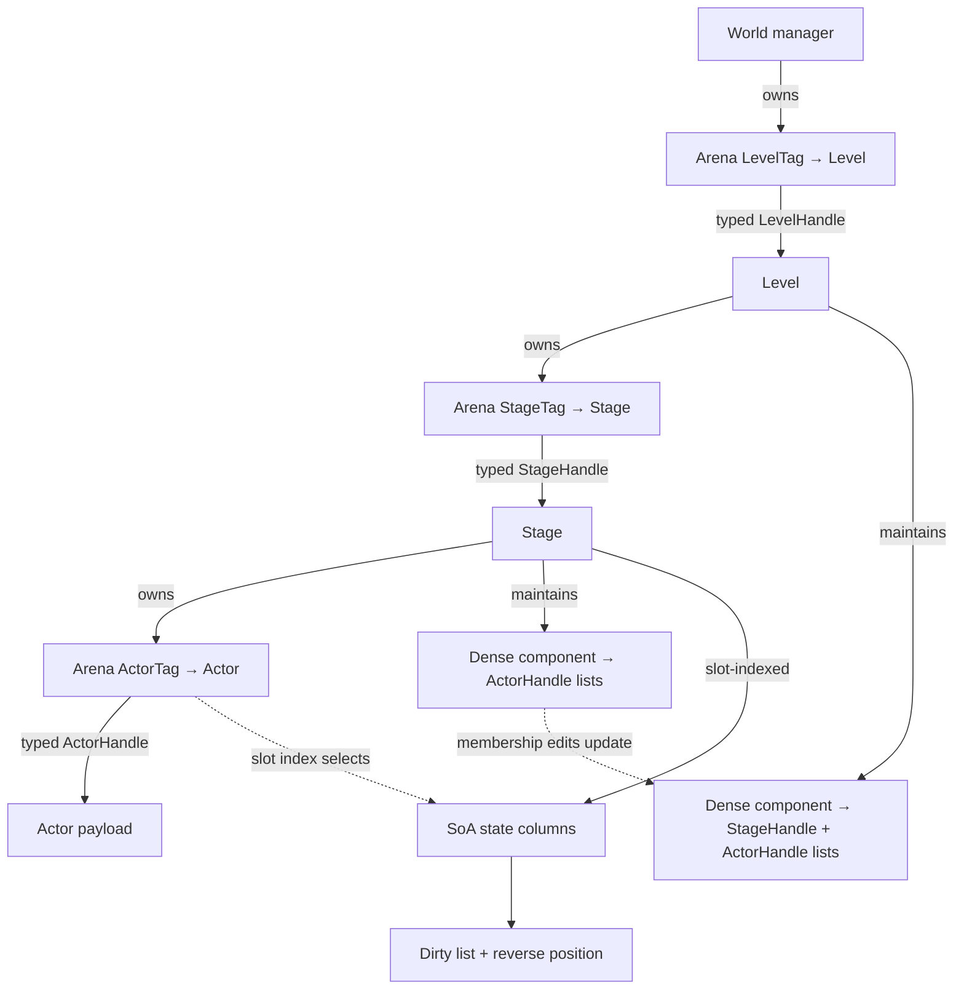

# Skein: Typed Arena Hierarchy and Dense Projections

**Status:** Proposed  
**Version:** 1  
**Date:** 2026-11-09

## Abstract

Skein is this RFC's short name for a reusable storage and traversal pattern for systems with nested owners, typed entities, frequently queried subsets, and incremental updates. It combines four mechanisms into one structure:

1. typed generational handles identify live objects in per-type arenas;
2. each hierarchy node owns the arena for its immediate children;
3. hot query results are materialized as dense handle lists with reverse positions for constant-time maintenance;
4. frequently updated columns use structure-of-arrays storage and dirty queues so work is proportional to changed items.

The hierarchy provides ownership and lifetime boundaries. Dense projections provide fast traversal across those boundaries. SoA columns provide cache-friendly bulk work. Reverse indexes and dirty queues connect mutations back to the projections that must change. Together they avoid making a hash table or a full hierarchy walk the default path for every operation.

This RFC generalizes patterns observed in Dumpster Fire Engine's manager, world, level, stage, arena, and traversal code. It is a design pattern, not a claim that every workload should use every layer or cache.

## 1. Goals

- Make handles distinguishable by object kind at compile time and reject stale slots at runtime.
- Make common membership changes and direct lookups O(1).
- Make iteration over a selected subset O(k), where `k` is the number of matching live objects.
- Make incremental updates O(d), where `d` is the number of dirty objects, rather than O(n) over all objects.
- Keep hot traversal over contiguous dense arrays and hot numeric fields over SoA columns.
- Allow queries at a parent level to reuse maintained child-level results without walking every descendant.
- Make memory and maintenance costs explicit so projections are added only where query reuse pays for them.

## 2. Non-goals

- Requiring an ECS, scene graph, or any particular domain model.
- Replacing a relational database, general-purpose map, or archival format.
- Caching every possible ancestor query. Each projection has a memory and write-maintenance cost.
- Requiring a fixed-width capacity limit, a particular vector crate, SIMD ISA, or thread pool.
- Claiming a universal speedup over hash tables. The target is a workload with repeated typed lookup, subset iteration, or dirty-only traversal.

## 3. One connected structure

The central rule is: **each owner stores its immediate children in a typed arena, and each frequently queried relationship is represented by a dense projection maintained from those child arenas.** Hot per-object fields are stored in parallel columns indexed by the arena slot.



The levels are not independent data structures bolted together after the fact:

- The arena owns identity and lifetime at one level.
- A typed handle is the stable reference used by the owning parent and every projection.
- A dense projection is a maintained view of memberships below its owner.
- A reverse position tells the mutation path exactly where that handle sits in each view.
- SoA columns use the same arena slot index, so dense iteration can fetch hot data without searching an object map.
- Dirty lists are dense projections of the subset whose SoA values need recomputation.

The full update path is therefore local and explicit: mutate a child, update its owner's dense membership and reverse position, propagate the corresponding membership delta to any materialized ancestor projection, and enqueue only the affected state rows for recomputation.

## 4. Typed generational identity

### 4.1 Handle shape

A handle is conceptually:

```rust
struct Handle<Tag> {
    slot: u32,
    generation: NonZeroU32,
    _tag: PhantomData<fn() -> Tag>,
}
```

`Tag` is a zero-sized marker. It prevents using an actor handle where a stage handle is expected without adding runtime bytes. `NonZeroU32` reserves an invalid bit pattern, allowing `Option<Handle<Tag>>` to use the same size as a handle on Rust targets with the expected niche layout. The slot selects storage; the generation proves that the slot still refers to the same object incarnation.

An external or persistent domain ID is distinct from an arena handle. An ID names a logical object across storage moves or reloads; a handle names a current slot incarnation. Do not use a reusable slot number as a persistent identifier.

### 4.2 Arena contract

Each arena is parameterized by a distinct tag and owns slots plus a free-slot stack:

```text
Arena<Tag, T>
  slots: contiguous Slot<T> array
  free:  compact list of vacant slot indices

Slot<T>
  generation: NonZeroU32
  value:       Option<T>
```

Required operations and bounds:

| Operation | Expected cost | Notes |
|---|---:|---|
| `get(handle)` | O(1) | Check slot bounds, generation, and occupancy. |
| `insert(value)` | Amortized O(1) | Reuse a free slot or append. Growth can relocate the slot vector, so callers retain handles rather than references. |
| `remove(handle)` | O(1) | Validate, vacate, advance generation, and add the slot to the free list. |
| dense arena iteration | O(n) | Scan slots or a separate live-slot list, depending on occupancy and iteration needs. |

Generation exhaustion must have a specified policy. The safe default is to retire a slot rather than wrap to a generation that could make an old handle valid again. The free-list policy must never make a vacant slot appear live.

`Slot<T>` is an AoS identity/lifetime record. This is not a requirement that all hot component data live inside `T`; high-volume numeric fields should be split into SoA columns when measured traversal benefits outweigh the extra coordination.

## 5. Hierarchy and references

### 5.1 Ownership edges

An owner contains the arena for its immediate children. In the reference shape:

```text
World  owns Arena<LevelTag, Level>
Level  owns Arena<StageTag, Stage>
Stage  owns Arena<ActorTag, Actor>
```

Parent-to-child edges use the child's typed generational handle. A child may carry an owner handle when upward navigation is needed. These handles make the relationship explicit while avoiding raw pointers into growable vectors.

The hierarchy boundary is also a useful parallel-work boundary: independent stages can update concurrently if their output columns and shared resources do not overlap. The implementation must prove disjoint writes or use synchronization; the hierarchy alone does not make mutation thread-safe.

### 5.2 Materialized ancestor projections

A local stage query can use a per-component dense list of `ActorHandle`s. A level-wide query can maintain a dense list of `(StageHandle, ActorHandle)` pairs for each queried component type. This lets the level visit only matches rather than recursively visiting every stage and actor.

Materialize an ancestor projection only when repeated queries save more than the cost of maintaining it. For a query used once after each mutation, walking the hierarchy may be cheaper. For a hot query repeated many times between structural changes, the maintained projection can amortize its update cost.

Every projection entry must be resolvable through its typed handle. Deleting or moving a child must remove old entries before their slots can be reused. Generation checks provide a final stale-entry defense; they do not replace correct cache maintenance.

## 6. Dense subset indexes

For each frequently queried type or predicate, store matching handles contiguously:

```text
dense_members: [Handle; count]
slot_to_dense_position: [position; arena_capacity]
```

The reverse position uses an invalid sentinel for non-members. Membership insertion appends to `dense_members` and records its position. Removal uses `swap_remove`; if the last element moves into the removed position, update that moved handle's reverse position.

| Operation | Expected cost |
|---|---:|
| Membership test | O(1) reverse-position check, followed by handle validation where required. |
| Add membership | Amortized O(1). |
| Remove membership | O(1) with `swap_remove` and one reverse-position repair. |
| Iterate matches | O(k), sequential over dense handles. |

The reverse-position width is a design choice. A `u16` position costs 2 bytes per possible slot per index but requires each dense set to stay below its sentinel (for example, `u16::MAX`). A `u32` position costs 4 bytes and supports larger sets. A wider position must be used or the set must be partitioned if the bound can be exceeded. This limit is per dense list, not necessarily per arena.

When there are many component types, a full `capacity × type_count` reverse-position matrix may dominate memory. Alternatives include a compact per-slot membership record, sparse reverse maps for rare types, or only maintaining reverse positions for the hot projections. Measure query frequency and mutation rate before selecting the representation.

## 7. SoA columns and dirty traversal

For hot fields such as transforms, store columns by arena slot rather than embedding all fields in an actor record:

```text
local_transform[slot]
world_transform[slot]
dirty_flag[slot]
dirty_dense[]
slot_to_dirty_position[slot]
```

Marking dirty is idempotent: if the flag is clear, set it, append the slot/handle to `dirty_dense`, and store the reverse position. Repeated writes while already dirty do not append duplicates. Processing walks only `dirty_dense`, updates the corresponding SoA rows, then clears flags and positions. Removing an item from a dirty list uses the same swap-remove repair as component membership.

| Workload | Expected cost |
|---|---:|
| Mark a clean item dirty | Amortized O(1). |
| Mark an already dirty item | O(1), without a duplicate queue entry. |
| Process dirty rows | O(d), sequential over dirty entries. |
| Full recomputation | O(n), reserved for invalidation or when `d` is close to `n`. |

Keep identity/lifetime checks on structural API boundaries. Inside a proven dense traversal, load the slot once and reuse it for aligned SoA columns; avoid re-resolving the same handle through a map for each field. This optimization is valid only while the traversal holds a stable mutation boundary and the slot cannot be removed or reused concurrently.

## 8. Traversal and parallel work

Prefer traversal from the narrowest maintained dense list that answers the query:

1. direct typed handle for one object;
2. local component list for one stage;
3. materialized ancestor projection for repeated level/world queries;
4. full recursive traversal when no projection exists or the query is broad.

For a per-stage transform pass, iterate dirty slots and access SoA columns in lockstep. Static unrolling can reduce loop overhead for small fixed groups, but should be retained only when generated code and measurements show a win. Vectorize independent numeric columns where semantics permit; preserve a scalar or portable fallback for unsupported targets.

Parallelize at a granularity with enough work to amortize scheduling. Independent child owners (such as stages) make natural jobs because they have separate local arenas and columns. A work-stealing pool can balance uneven jobs, but tasks that are too small can cost more than their work. Set thresholds from end-to-end measurements on representative machines; do not treat a single benchmark cutoff as universal.

## 9. Invariants

An implementation conforming to this RFC must preserve these invariants:

1. A handle's tag matches the arena it is used with.
2. A handle resolves only when slot, generation, and occupancy all match.
3. A freed slot cannot validate an earlier handle, including after generation exhaustion.
4. Every dense membership has exactly one correct reverse position; every absent membership has the invalid sentinel.
5. Every `swap_remove` repairs the displaced element's reverse position.
6. Every materialized ancestor projection is updated on insert, remove, and reparent operations.
7. A removed child is removed from all projections and dirty sets before its slot is reusable.
8. SoA rows and arena slots share a documented index/lifetime rule.
9. Dirty queues contain no duplicate live entries for the same dirty category.
10. Parallel jobs write disjoint state or use explicit synchronization.

## 10. Memory and cost model

Let:

- `N` be arena capacity;
- `M` be the number of live dense memberships across maintained indexes;
- `A` be the number of materialized ancestor-query entries;
- `D` be the number of dirty rows;
- `C` be the number of SoA bytes per arena slot.

Approximate storage, excluding allocator capacity slack and payloads:

```text
arena slots                 N × size_of::<Slot<T>>()
free list                   vacant_slots × 4 bytes (u32 slot index)
dense membership handles   M × size_of::<Handle>()
reverse positions           indexed_slots × position_width, per index
ancestor projections        A × size_of::<(ChildHandle, OwnerHandle)>()
SoA columns                  N × C
dirty queue                  D × slot_or_handle_width, plus flags and reverse positions
```

For a handle with two 32-bit fields, the nominal handle payload is 8 bytes; `PhantomData` adds no runtime bytes. Verify actual layouts with `size_of` on supported targets. A reverse position per component type can cost more than the handles when type count is high, so index only useful query paths.

The time and space exchange is deliberate: dense projections add write work and memory to avoid repeated search or recursive scans. The break-even point depends on query rate, mutation rate, match density, and cache behavior. Bench both the mutation-plus-query cycle and the query alone.

## 11. Failure cases and tradeoffs

- **Low query reuse:** maintaining ancestor projections costs more than rebuilding a traversal. Omit or lazily build them.
- **High structural churn:** dense lists remain O(1) to update, but broad changes may make rebuilding cheaper. Benchmark both.
- **Sparse reverse arrays across many types:** memory can grow as capacity times index count. Use selective or compressed reverse metadata.
- **Small dense-position type:** a sentinel can be confused with a valid position if capacity is not bounded. Enforce the bound or use a wider type.
- **Generation wrap:** stale handles can become valid if generations wrap. Retire exhausted slots or use a formally safe policy.
- **Unstable references:** arena growth can relocate values. Store handles, not pointers/references, across growth or mutation.
- **Concurrent mutation:** generation checks do not provide synchronization. Use exclusive access, staged commands, or a synchronization scheme.
- **Dirty propagation dependencies:** a changed parent may make descendants dirty even if their local fields did not change. Encode and test propagation rules by dependency type.
- **Over-materialization:** every ancestor projection duplicates entries and adds mutation fan-out. Cache only measured hot queries.

## 12. Validation and benchmark plan

Correctness tests should cover:

- wrong-tag API misuse at compile time;
- remove/reinsert stale-handle rejection and generation exhaustion;
- membership add/remove, especially removing first/middle/last entries and repairing the moved reverse position;
- reparenting between owners and updates to every materialized ancestor index;
- dirty marking idempotence, clear/re-dirty, and swap-removal;
- slot reuse and SoA row initialization/reset;
- parallel and serial traversal parity.

Performance measurements should report both latency and total work for:

- arena get/insert/remove and dense iteration at several live-to-capacity ratios;
- hash lookup versus direct arena lookup;
- hash-set membership and scan versus dense reverse-index membership;
- local query versus maintained ancestor projection, including mutation cost;
- full scan versus dirty-only traversal at several dirty fractions;
- AoS versus SoA for the actual hot fields and access order;
- serial versus work-stealing execution across job sizes and worker counts.

Use repeated runs and report CPU, compiler, target features, dataset shape, warm/cold cache condition, allocation policy, and whether setup is included. A microbenchmark of one lookup does not establish end-to-end superiority; benchmark the complete mutate-query-update cycle.

## 13. Reference mapping

The following Dumpster Fire Engine files provide the source pattern this RFC generalizes:

- [`manager.rs`](https://github.com/oda-00/dumpster_fire_engine/blob/master/src/resource_manager/manager.rs) — tagged generational handles, arena slots, and free-list operations.
- [`world.rs`](https://github.com/oda-00/dumpster_fire_engine/blob/master/src/resource_manager/world_manager/world.rs) — top-level ownership and traversal.
- [`level.rs`](https://github.com/oda-00/dumpster_fire_engine/blob/master/src/resource_manager/world_manager/level.rs) — child-stage ownership and level-wide component projections.
- [`stage.rs`](https://github.com/oda-00/dumpster_fire_engine/blob/master/src/resource_manager/world_manager/stage.rs) — actor arena, component caches, reverse positions, SoA transform storage, dirty traversal, and stage-level work.
- [`asset.rs`](https://github.com/oda-00/dumpster_fire_engine/blob/master/src/resource_manager/asset_manager/asset.rs) — asset arena with dense per-type handle caches and reverse positions.
- [`arena_micro.rs`](https://github.com/oda-00/dumpster_fire_engine/blob/master/benches/arena_micro.rs) and [`component_storage.rs`](https://github.com/oda-00/dumpster_fire_engine/blob/master/benches/component_storage.rs) — focused arena and component-storage benchmarks.

These files are examples, not normative dependencies. Skein implementations should preserve the invariants and validate the cost model for their own data and machine targets.

## 14. Prior art and terminology

Skein is a name for the composition in this RFC, not a claim that its component ideas are new or that the name is unique. The parts have established names and related implementations:

- **Generational arena:** slot-plus-generation handles are an established way to detect stale references after slot reuse. The Rust [`generational-arena` crate](https://docs.rs/generational-arena/latest/generational_arena/) documents this approach and its ABA-prevention purpose.
- **Packed sparse set:** a sparse index maps an identifier to a position in a packed array. EnTT documents this two-array sparse-set representation and its dense iteration behavior in its [sparse-set reference](https://skypjack.github.io/entt/classentt_1_1basic__sparse__set.html).
- **Cached query results:** ECS implementations commonly cache which storage tables or archetypes match a query. Bevy's [`QueryState`](https://docs.rs/bevy/latest/bevy/ecs/prelude/struct.QueryState.html) is one example. Skein's proposed ancestor projection stores matching child handles across explicit owner levels; this is related query caching, but is not the same storage model as an archetype ECS.
- **SoA and dirty tracking:** columnar data layout and tracking changed rows are established data-oriented techniques. Tecs describes per-component dirty tracking and incremental consumers in its [dirty-tracking documentation](https://tecs.dev/ecs/components/dirty-tracking/index.html).

The distinctive scope here is the explicit combination: typed generational arenas define nested ownership; dense reverse-indexed projections maintain selected queries at more than one owner level; and slot-aligned SoA columns plus dirty queues drive incremental traversal. This search found no single widely established name for that exact combination, but that is not proof that no prior implementation exists. Treat Skein as a convenient local name, not a novelty claim.

The earlier working name “Trellis” was dropped because **trellis** is already an established graph term, especially for layered directed graphs used in coding theory. A trellis graph represents paths through ordered state layers; Skein's arenas and projections do not implement that graph structure. See this [MIT thesis definition of a trellis](https://cba.mit.edu/docs/theses/09.06.Chen.pdf).

## 15. Adoption guidance

Adopt Skein incrementally:

1. Define object tags, arena ownership, and stale-handle semantics.
2. Add a dense reverse-indexed set only for a query that is demonstrably hot.
3. Move hot bulk fields to slot-indexed SoA columns when traversal measurements justify the coordination cost.
4. Add dirty queues for fields with sparse updates and explicit dependency propagation.
5. Add ancestor projections only for repeated queries whose saved traversal time exceeds maintenance and memory cost.
6. Add parallel jobs only after serial traversal and per-job cost are measured.

At every step, keep a reference traversal or full recomputation available in tests as a correctness oracle.
